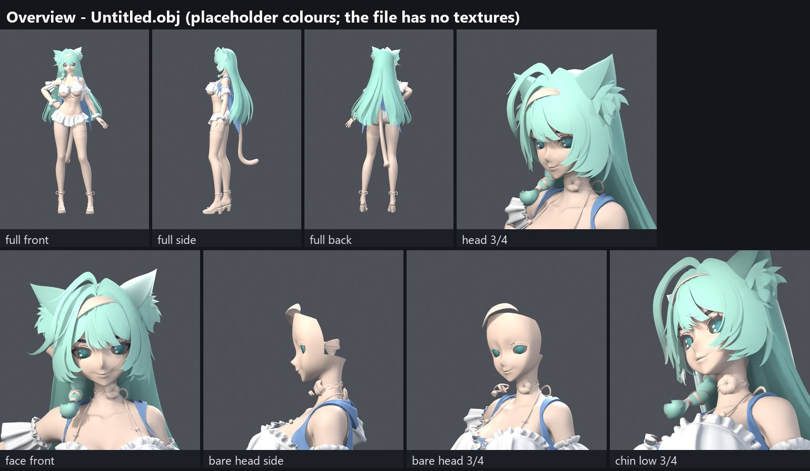
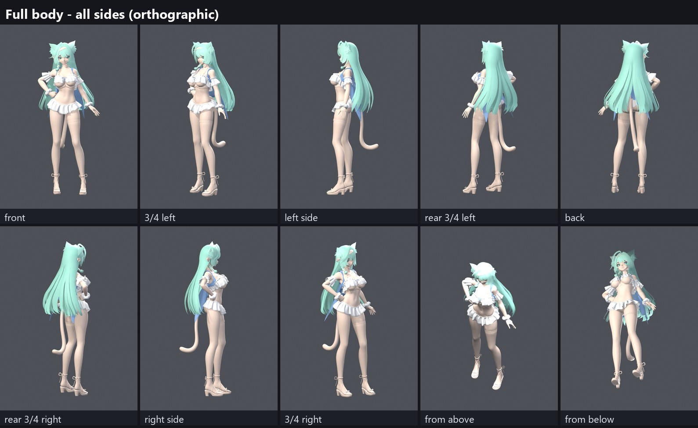
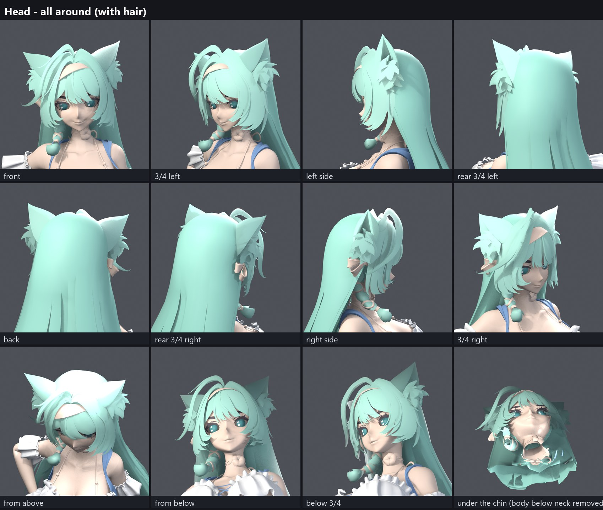
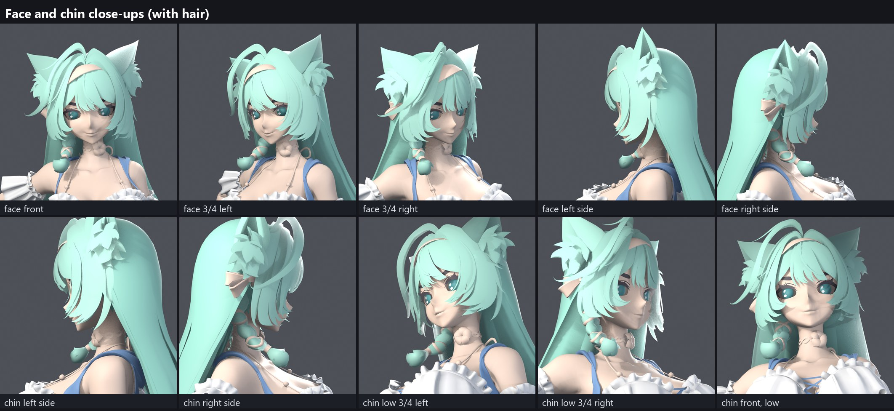
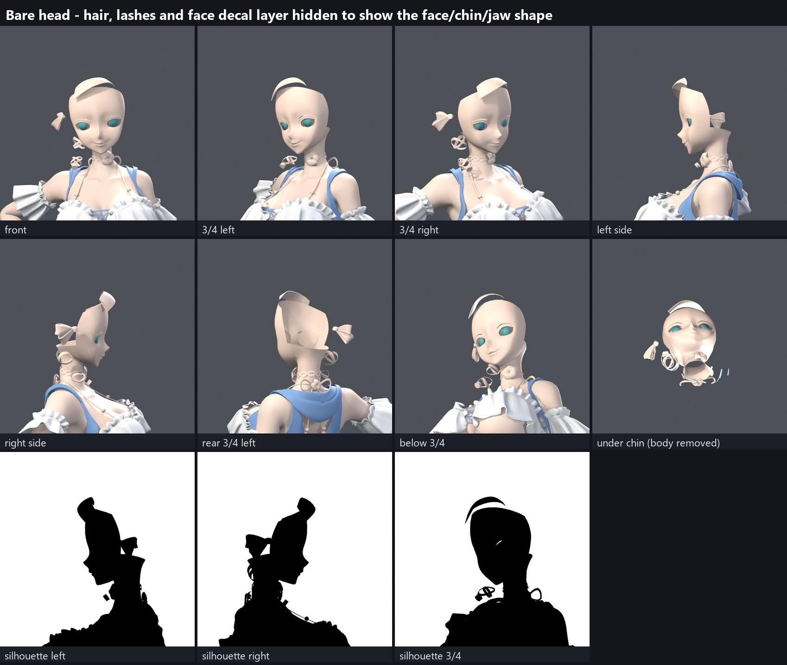
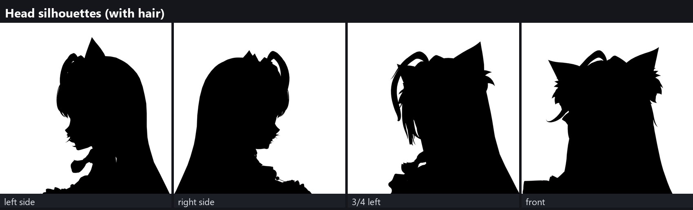

# Character Model Render Review

Lit renders of an anime-style character model (`Untitled.obj`, 92,291 triangles) made in Blender 5.3 for review, with extra focus on the head, face and chin. **Renders only:** the model file itself is not included.

**For an AI reviewer:** [`MODEL_SUMMARY.txt`](MODEL_SUMMARY.txt) has the mesh statistics as text, and [`DESCRIPTION.txt`](DESCRIPTION.txt) describes what the renders show. Raw links:
- https://raw.githubusercontent.com/bv8dpwfzrj-sudo/character-render-review/main/MODEL_SUMMARY.txt
- https://raw.githubusercontent.com/bv8dpwfzrj-sudo/character-render-review/main/DESCRIPTION.txt
- https://raw.githubusercontent.com/bv8dpwfzrj-sudo/character-render-review/main/sheets/OVERVIEW.jpg

**How it was rendered:** Eevee, three area lights that follow the camera (warm key upper-front, cool fill on the other side, rim light from behind) plus soft ambient light. The OBJ has no textures, so each material got a placeholder colour (mint hair, skin, white and blue outfit). Full-body views are orthographic; head and face views use an 85 mm lens.

## Overview

## Full body, all sides

## Head, all around (with hair)

## Face and chin close-ups

## Bare head (hair, lashes and face-detail layer hidden)
The hair covers the face from the side, so these views hide it to show the real face, chin, jaw and neck shape. The head mesh has no skull under the hair, so it is open at the top and back.

## Head silhouettes (with hair)

Every individual view is in [`views/`](views) (1000×1000 for head shots).

**Notes:** the two "under the chin" shots use a copy of the model with everything below the neck removed, because the chest blocks the chin from any low angle.
